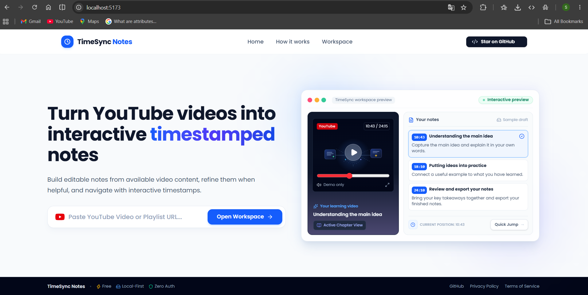
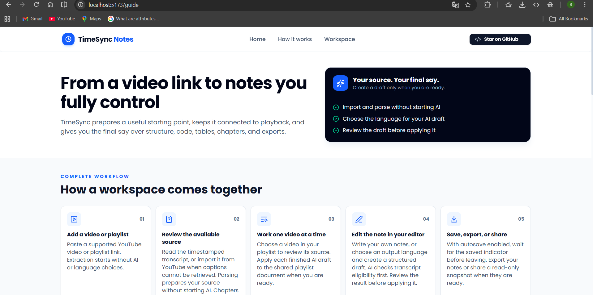
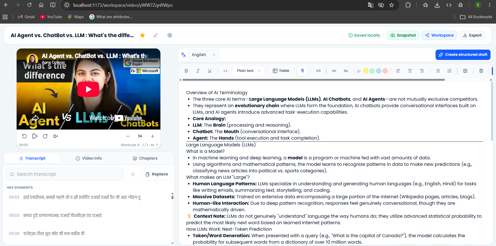
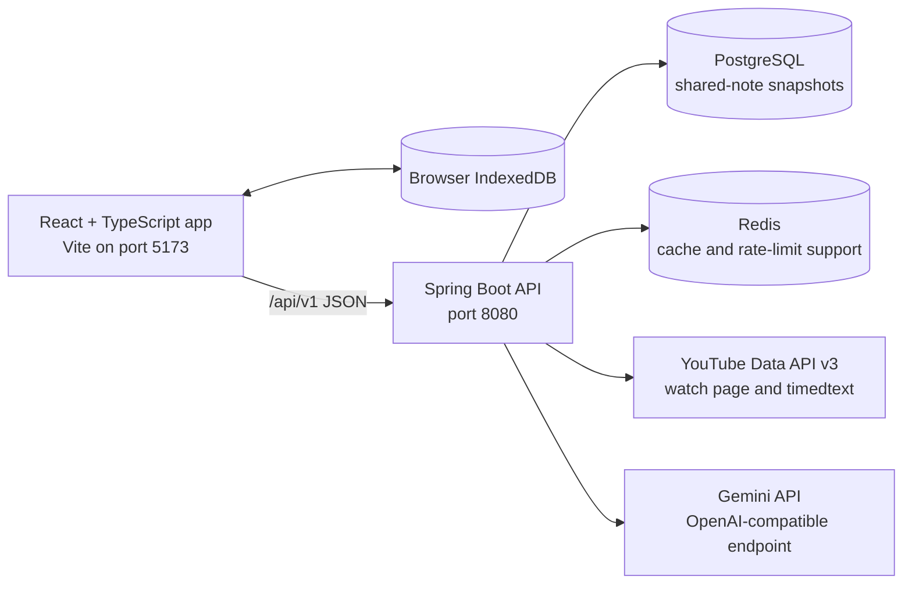

# ⏱️ TimeSync Notes

**Turn educational YouTube videos into timestamped, editable study notes.** TimeSync Notes keeps transcript parsing separate from AI drafting, lets you review and edit the result, and saves your workspace in the browser.

> This repository contains the React + TypeScript frontend and Spring Boot backend. The app currently has **zero authentication**: anyone who can reach a deployed API can call it. Review the security and deployment notes before making a public deployment.

## 📸 Screenshots

### 🏠 Home

Paste a YouTube video or playlist link and open the workspace. The interactive preview demonstrates how playback and notes work together.



### 🧭 How it works

Follow the workflow from importing a source through reviewing and exporting your notes.



### 📝 Workspace

Review synchronized playback, transcript, video details, chapters, output language, and the editor in one workspace.



## ✨ What it does

- 🎬 Extracts public YouTube video and playlist metadata, captions, and available native chapters.
- 🧾 Parses a user-provided timestamped transcript when captions cannot be retrieved.
- ✅ Requires transcript evidence for educational-content verification; metadata alone is not enough.
- 🤖 Creates an AI draft only when the user asks, in **English**, **Hindi**, or **Hinglish**.
- 📚 Supports playlists, editable chapter markers, transcript search, and playback shortcuts.
- 💾 Saves workspace and draft data locally in the browser with IndexedDB.
- 📄 Edits and exports notes, including PDF, and creates read-only share snapshots.

## 🧱 How the pieces fit together



### 🛠️ Main technologies

| Area | Technologies |
| --- | --- |
| Frontend | React, TypeScript, Vite, React Query, Zustand, TipTap |
| Browser storage and exports | IndexedDB, jsPDF, html2canvas |
| Backend | Java 17, Spring Boot 3, Maven, Spring Data JPA |
| Data services | PostgreSQL for shared-note snapshots; Redis for cache and rate-limit support |
| External providers | YouTube Data API v3, YouTube watch/timedtext requests, Gemini API |
| Local infrastructure | Docker Compose for PostgreSQL and Redis; Dockerfile for backend image |

## 📁 Repository layout

```text
TimeSync/
├── frontend/                 # React and TypeScript application
│   ├── src/features/         # Landing, extraction, notes, and workspace features
│   └── tests/                # Vitest and Testing Library tests
├── backend/                  # Spring Boot API
│   ├── src/main/java/        # Controllers, services, integrations, and configuration
│   ├── src/test/             # Backend unit and controlled integration tests
│   ├── Dockerfile            # Multi-stage Java 17 backend image
│   ├── docker-compose.yml    # Local PostgreSQL and Redis only
│   └── README.md             # Backend setup, configuration, and operations
├── docs/screenshots/         # README product screenshots
├── .gitignore
└── README.md
```

## 🚀 Run locally

### Prerequisites

- **Node.js 20+** and npm
- **Java 17**
- Docker Desktop with Docker Compose
- YouTube Data API and Gemini API keys for provider-backed features

### 1. Configure the backend

In PowerShell, open the `backend/` directory. Create `.env` from the safe template once, then add your local service passwords and provider keys:

```powershell
Copy-Item .env.example .env
```

If `backend/.env` already exists, do **not** overwrite it. `.env` files are ignored by Git and Docker. Keep provider keys on the backend; never put them in frontend `VITE_*` variables.

### 2. Start PostgreSQL and Redis

Still in `backend/`:

```powershell
docker compose up -d
docker compose ps
```

Compose starts only PostgreSQL and Redis. Their host ports bind to loopback. It does **not** start the backend application.

### 3. Run the backend

Spring Boot does not read `.env` automatically. In IntelliJ, set the values from `backend/.env` in the run configuration, or import them into PowerShell and start the app:

```powershell
Get-Content .env | Where-Object { $_ -match '^\s*[^#=]+=.*$' } | ForEach-Object {
    $name, $value = $_ -split '=', 2
    [Environment]::SetEnvironmentVariable($name.Trim(), $value, 'Process')
}
.\mvnw.cmd spring-boot:run
```

The backend listens on **http://localhost:8080** by default and exposes **http://localhost:8080/actuator/health** for a basic health check.

### 4. Run the frontend

In a second terminal, open `frontend/`:

```powershell
npm ci
npm run dev
```

Open **http://localhost:5173**. Vite proxies `/api` calls to the local backend on port `8080`.

## 🔌 Application API

The browser talks to the backend JSON API under `/api/v1`. The Vite proxy keeps local development same-origin; production uses the configured frontend API base URL. The examples below show the backend route without the common `/api/v1` prefix.

| Method and route | Purpose | Request body / result |
| --- | --- | --- |
| `POST /extract/video` | Start a source-only video extraction. | `{ "url": "https://www.youtube.com/watch?v=VIDEO_ID" }` → `TranscriptResponse` |
| `GET /extract/video/{videoId}` | Restore/refresh stable video source data without spending AI draft quota. | 11-character YouTube ID → `TranscriptResponse` |
| `POST /extract/video/transcript` | Parse a pasted timestamped transcript. | `{ "videoId": "…", "transcript": "…", "chapters": [], "editableChapters": true }` → `TranscriptResponse` |
| `POST /extract/video/refine` | Verify transcript evidence and queue an AI draft in the selected language. | `videoId`, `transcript`, optional `transcriptSegments`, `transcriptLanguage`, `chapters`, `editableChapters`, and `targetLanguage` → HTTP `202` and a response containing AI status/job information |
| `GET /extract/ai/jobs/{jobId}` | Poll an AI draft job. | UUID job ID → `AiNoteJobResponse` with `QUEUED`, `PROCESSING`, `COMPLETED`, or failure status and result when complete |
| `POST /extract/playlist/jobs` | Queue playlist extraction. | `{ "playlistUrl": "https://www.youtube.com/playlist?list=PLAYLIST_ID" }` → HTTP `202` and job information |
| `GET /extract/playlist/jobs/{jobId}` | Poll playlist extraction. | UUID job ID → status and partial-success result when complete |
| `POST /extract/playlist` | Extract a playlist synchronously. | `{ "playlistUrl": "…" }` → `PlaylistTranscriptResponse` |
| `GET /extract/playlist/{playlistId}` | Restore/refresh playlist source data. | YouTube playlist ID → `PlaylistTranscriptResponse` |
| `POST /notes/share` | Create a read-only note snapshot. | `videoId`, `videoTitle`, `noteContent`, `cleaningStage` → HTTP `201` and share URL/expiry |
| `GET /notes/{hashId}` | Read a share snapshot. | Share ID → `SharedNoteResponse`; response is `no-store` |
| `GET /actuator/health` | Basic service health. | No request body; component details are hidden |

### Example: extract a video

```bash
curl -X POST http://localhost:8080/api/v1/extract/video \
  -H "Content-Type: application/json" \
  -d '{"url":"https://www.youtube.com/watch?v=VIDEO_ID"}'
```

`TranscriptResponse` carries video metadata, transcript segments, chapters and editability, transcript availability, verification state, source information, and AI job status. Field details are defined in `backend/src/main/java/com/timesync/notes/dto/response/TranscriptResponse.java`.

For temporary rate-limit responses, honor the `Retry-After` header or `retryAfterSeconds` body field when returned. The backend’s exact configuration, failure codes, and operational guidance are in [`backend/README.md`](backend/README.md).

## 🌐 Third-party APIs and services

| Provider/service | What the app uses it for | Key/configuration |
| --- | --- | --- |
| **YouTube Data API v3** | Video metadata and playlist metadata/items (`videos`, `playlists`, `playlistItems`). | Backend-only `YOUTUBE_API_KEY` |
| **YouTube watch page** | Watch-page HTML/player data used for native chapter and source discovery. | No API key in the browser; subject to YouTube availability and throttling |
| **YouTube timedtext** | Caption-track discovery and caption downloads. | Backend request; signed caption URLs are not exposed in application logs |
| **Google Gemini API** | Transcript verification and AI note drafting, through Gemini’s OpenAI-compatible chat completions endpoint. | Backend-only `GEMINI_API_KEY`; model names and timeouts are configurable |
| **PostgreSQL** | Persistent read-only share snapshots. | `POSTGRES_*` environment variables |
| **Redis** | Shared cache/rate-limit support where configured. | `REDIS_*` environment variables |

YouTube’s watch-page and timedtext requests are content endpoints, not a separate player API. They can change or be throttled independently of the official Data API. Transcript evidence remains required for semantic verification; metadata alone does not approve a workspace.

## 🧪 Tests and build checks

From `frontend/`:

```powershell
npm test
npm run lint
npm run build
```

From `backend/`:

```powershell
.\mvnw.cmd clean install
```

The backend test suite uses mocks and controlled local fixtures rather than depending on live YouTube or Gemini calls.

## 🐳 Backend Docker image

From `backend/`:

```powershell
docker build -t timesync-notes-backend:local .
```

The multi-stage image builds with Maven/Java 17 and runs on a Java 17 JRE as a non-root user. `.dockerignore` keeps local secrets and generated build output out of the Docker build context.

## ☁️ Deployment outline

- **Backend:** deploy the `backend/` Dockerfile on Render. Set the database, Redis, provider key, allowed frontend origin, and public app URL in Render’s environment settings. Use hosted PostgreSQL and Redis-compatible services; the local Compose containers are not production services.
- **Frontend:** deploy the `frontend/` folder on Vercel. Set the production API base URL to the Render API origin plus `/api/v1`.
- **CORS:** set backend `ALLOWED_ORIGINS` to the exact deployed Vercel origin.
- **Scaling:** job/cooldown state has process-local components. Use one backend instance unless those states are moved to shared infrastructure.

## 🔐 Security and privacy notes

- This project intentionally has **zero user authentication**. Public API routes can be called by anyone who can reach the backend. Rate limits and provider budgets help control use but do not create per-user quotas.
- Never commit `.env`, provider credentials, signed caption URLs, cookies, transcripts, or private user content.
- Keep API keys in backend environment settings only. Rotate keys immediately if they are accidentally exposed.
- Configure CORS narrowly and do not trust forwarded headers unless a trusted proxy sanitizes them.
- Workspace and draft persistence is browser-local (IndexedDB); shared-note snapshots are stored by the backend and expire after the configured TTL (24 hours by default).

## 📜 License

No license file is included in this repository.